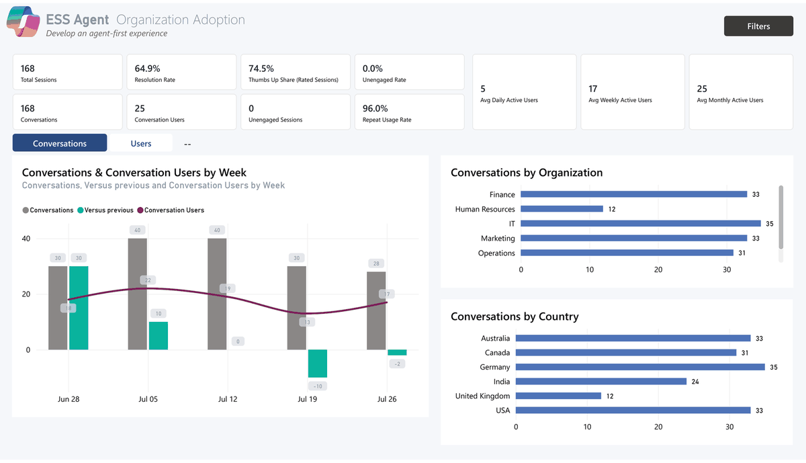

# ESS Insights — Employee Self-Service Agent Analytics

> **Measure the real-world impact of your Microsoft Employee Self-Service (ESS) Copilot Studio agent — adoption, outcomes, deflection, and user feedback — using only the data your agent already produces.**

A drop-in Power BI template purpose-built for the **Microsoft ESS agent**, with a 9-page executive dashboard that answers the questions HR, IT, and the executive sponsor will actually ask after launch.

> 📊 **Primary data source:** This report leverages the **`ConversationTranscript` Dataverse table** that Copilot Studio writes for supported agent channels. Microsoft 365 Copilot Chat reactions require the optional [cross-channel feedback export path](FEEDBACK-INGESTION.md), because those reactions are not stored in the Dataverse transcripts.

> 💡 Built for ESS, but works for **any Copilot Studio agent** — the same template will load and analyze transcripts from any agent (HR, IT, sales enablement, custom). See [Customize for your agent](#customize-for-your-agent).

> 🎬 **New — ESS Insights Overview (video):** a quick video walkthrough of the dashboard's capabilities — the fastest way to see what it does before diving into setup.
>
> https://github.com/user-attachments/assets/efa683f8-edec-4a53-897b-8e02fc112f3f
>
> 📖 **New — [Interpretation Guide (PowerPoint)](ESS%20Insights%20Dashboard%20-%20Interpretation%20Guide.pptx):** a page-by-page walkthrough of every dashboard page — what each visual means and, more importantly, what to *do* with it. Numbered markers connect each chart to plain-language interpretation and a recommended next step.
>
> 📈 **Companion deck — [Topic to Time Savings](Topic%20to%20Time%20Savings.pptx):** shows how to translate topic-level conversation data into a defensible hours-saved and dollar-value estimate for the Business Impact page.

---

> ### 🚀 New here? Start in 4 steps
> **1.** [Download the package](#download-the-complete-self-service-package) → **2.** [Choose one path](#choose-your-path) → **3.** Follow only that path's guide → **4.** Open its Power BI template and validate the report.
>
> **Jump to:** [Download the package](#download-the-complete-self-service-package) · [Choose your path](#choose-your-path) · [Common prerequisites](#common-prerequisites) · [Troubleshooting](#validation--troubleshooting)

---

## Download the complete self-service package

[**Download ESS Insights as a ZIP**](https://github.com/microsoft/ESS/archive/refs/heads/main.zip), select **Extract All**, and open the extracted `ESS-main` folder. Keep the folder structure intact.

**Download the ZIP only once. Do not download `.cmd` or `.py` files separately.** Every required template, launcher, notebook, and helper is already in the package. After extraction, choose one path below; its guide identifies exactly what to open and where to export any required data.

---

## Choose your path

All three paths use the same ESS reporting model. Dataverse V21 discovers agents from the loaded transcripts and exposes a synchronized **Agent** filter. Its basic setup does not require an agent registry; the selected setup guide explains if and when one is needed.

<table>
<tr>
<td width="33%" valign="top">

### 🟢 Evaluate or share a snapshot
**CSV Upload**

Best for a first evaluation, a one-time export, an offline copy, or sharing a controlled snapshot. You manually export `ConversationTranscript` again whenever you want newer data.

➡️ **[Start with CSV Upload](SETUP-CSV-Download.md)**

</td>
<td width="33%" valign="top">

### 🔵 Monitor one environment
**Dataverse Direct — recommended**

Best production default for one supported Dataverse environment. The setup tool first generates a prefilled Desktop validation PBIT for all available sources, then a separate environment-specific production PBIT that refreshes Dataverse cloud-to-cloud without a gateway.

Extend Dataverse retention for the reporting period you need; report refresh does not archive deleted records.

➡️ **[Start with Dataverse Direct](SETUP-Dataverse.md)**

</td>
<td width="33%" valign="top">

### 🟣 Preserve or consolidate at scale
**Fabric Lakehouse — advanced**

Use when you need independently governed history, multiple Dataverse environments in one report, very large-scale ingestion, or Lakehouse-based credit analytics.

Fabric preserves only records ingested before Dataverse deletes them and requires more administration.

➡️ **[Start with Fabric Lakehouse](SETUP-Fabric.md)**

</td>
</tr>
</table>

> 🧪 **Just exploring?** Start with **CSV Upload** and the fabricated files in [`SampleData`](SampleData/). No customer data is required.

### Compare all three paths and see what to run

| | 🟢 **CSV Upload** | 🔵 **Dataverse Direct** | 🟣 **Fabric Lakehouse** |
|---|---|---|---|
| **Best for** | Evaluation, snapshots, demos, controlled sharing | Ongoing production reporting for one environment | Durable governed history, multiple environments, or very large scale |
| **How transcripts load** | Manual Dataverse CSV export | Native Power BI Dataverse connector | Scheduled notebook writes Delta tables |
| **Typical setup** | 20–30 minutes | 15–25 minutes | 30–60+ minutes plus administrator setup |
| **Refresh** | Replace the CSV and refresh | Schedule Power BI refresh | Schedule notebook ingestion, then semantic-model refresh |
| **Power BI gateway** | None for SharePoint/OneDrive; required for local or network paths | None | None for the Lakehouse SQL analytics endpoint |
| **Primary access** | Dataverse transcript read/export access | Bot Transcript Viewer | Fabric access plus a Dataverse application user |
| **Historical behavior** | Snapshot contains only records retained when exported | Queries only records still retained in Dataverse | Merge preserves records already ingested into Delta |
| **Template** | `ESS Dashboard - Dynamic Topics (CSV) V18.pbit` | Service-refresh PBIT generated from `ESS Dashboard - Dynamic Topics (Dataverse) V21.pbit` | `ESS - Fabric V2.pbit` |
| **First package action** | [Create `agent-registry.json`, then open the included CSV PBIT](SETUP-CSV-Download.md#step-4--build-the-registry-and-open-the-included-template) | [Double-click `START-HERE-DATAVERSE.cmd`](SETUP-Dataverse.md#step-4--create-the-validated-desktop-template) | [Complete the administrator setup, then import the included notebooks](SETUP-Fabric.md#one-time-administrator-setup--create-the-dataverse-application-user) |
| **After the first validation** | Keep the validated report; replace the CSV and refresh when newer data is needed | [Run `BUILD-SERVICE-REFRESH.cmd` only when ready to publish for cloud refresh](SETUP-Dataverse.md#step-8--publish-to-power-bi-service-only-when-ready) | [Schedule the transcript notebook, then refresh the semantic model](SETUP-Fabric.md#step-3--run-or-schedule-the-notebooks) |
| **Agent registry** | Required for the recommended safe/selected scope; the guide creates JSON | Not required for basic setup; add only for custom labels or cross-system aliases | Required; upload the validated CSV to `Files/config` |
| **Optional customer-specific topics** | Follow the [topic tuner guide](TOPIC-TUNER.md), then paste the approved JSON parameter | Follow the [topic tuner guide](TOPIC-TUNER.md), then rerun the first launcher and select the approved JSON | Follow the [topic tuner guide](TOPIC-TUNER.md), then upload the approved CSV to `Files/config` |
| **Optional Microsoft 365 feedback** | Follow the [feedback guide](FEEDBACK-INGESTION.md), then paste the prepared JSON parameter | Follow the [feedback guide](FEEDBACK-INGESTION.md), then rerun the first launcher and select the prepared files | Follow the [feedback guide](FEEDBACK-INGESTION.md), then upload the prepared CSV to `Files/feedback` |
| **Python use** | Registry and optional local preparation only; no packages required | The launchers run Python for you; no coding or packages required | Registry and optional local preparation only; no packages required |
| **Complete instructions** | [CSV Upload guide](SETUP-CSV-Download.md) | [Dataverse Direct guide](SETUP-Dataverse.md) | [Fabric Lakehouse guide](SETUP-Fabric.md) |

### After you choose

1. Follow the selected setup guide above.
2. Complete the guide's minimum first run before adding optional data.
3. Use the in-report **Agent** filter to focus the analysis after loading.

---

<strong>🆕 What's new in CSV V18 / Dataverse V21</strong>

- **Safer multilingual topic classification** — native Copilot Studio topics remain authoritative. Conversations without a native topic use customer-neutral English, Spanish, and Chinese rules with word-boundary matching, scoring, exclusions, confidence, and ambiguity handling. This prevents partial-word collisions such as `tick` matching `ticket`.

- **Private customer-specific learning without template releases** — the optional [Private adaptive topic tuner guide](TOPIC-TUNER.md) explains how to learn reviewed local rules from native topic evidence. It emits no full prompts, and ambiguous or weak discoveries remain disabled.

- **Cross-channel reaction reporting** — transcript reactions and normalized Microsoft 365 Product Feedback or Copilot Studio Monitor exports combine into one deduplicated feedback table. The optional [Microsoft 365 feedback guide](FEEDBACK-INGESTION.md) owns the export, preparation, audit, and load steps.

- **Agent filtering without setup JSON** — Dataverse V21 loads the agents found in the selected environment and provides one synchronized Agent slicer across the analytical pages. Transcript and Power Platform consumption rows use the same GUID-based key automatically.

- **Optional advanced agent registry** — a customer-controlled mapping is still available when Microsoft 365 title IDs or custom cross-environment labels must be joined. See [Agent registry and reporting scope](AGENT-REGISTRY.md).

- **Parent and child agent attribution in every path** — connected-agent traces now populate conversation-level parent/child details in CSV, Dataverse, and Fabric. The Fix-It Queue shows the child agent, while Fabric also retains the event-grain invocation bridge. See [Parent and child agent attribution](CHILD-AGENT-ATTRIBUTION.md).

- **Fabric history and signal safety** — bounded Dataverse pulls now merge by default instead of overwriting older history. Fabric parses canonical `messageReaction` activities and preserves authoritative `SessionInfo` outcomes before using transparent fallback states.

- **Agent filtering on Improvement Opportunities** — the Dataverse Direct edition now includes an Agent slicer so multi-agent environments can isolate improvement opportunities for a single agent.

- **Validated Copilot Studio credits** — CSV V18 and Dataverse V21 Desktop/manual refresh accept the 30-day **User-Level Credit Consumption** export from the [Power Platform admin center](https://admin.powerplatform.microsoft.com). Credits match ESS through `Agent Id`; organization attribution uses `User Email`.

- **Guided Dataverse setup** — the Dataverse guide tells customers when to use each included double-click launcher. No command line or individual tool download is required.

- **Clear observed-versus-modeled labeling** — total and billable credits are observed Power Platform admin center values. Cost, cost per resolved conversation, net value, and ROI are modeled because the export provides no conversation or topic ID.

- **Fabric V2 decimal-credit support** — preserves fractional Copilot Credits and validates the three Power Platform admin center export schemas before writing the Lakehouse tables.

Dataverse Direct V21 and CSV Upload V18 are cumulative — both include every improvement from the earlier releases.

---

## Why use this template for your ESS agent

<strong>Click to expand</strong>

The Microsoft ESS agent gives your employees a single, conversational front door to HR, IT, payroll, benefits, and travel self-service. But the platform gives you *nested data*, not insights. This template answers the questions an ESS program owner needs to answer every month:

- **Are employees adopting it?** Distinct users, repeat usage, DAU/WAU/MAU trend
- **Is it actually resolving their requests?** Resolution vs. escalation vs. abandonment rates, by topic
- **How fast does it answer?** Avg duration, response time, turns to resolve
- **What is it saving the business?** Tickets deflected, hours saved, dollar value, credit cost
- **Are employees happy with it?** In-conversation thumbs, CSAT, verbatim comments
- **Which intents need authoring help?** Per-topic deflection, abandonment, and outcomes

All nine pages light up from the transcript source. Add optional companion files to unlock organization/country breakouts, Microsoft 365 Copilot Chat reactions, and credit cost analysis.

---

## What you get

<strong>Click to expand — 9-page dashboard overview</strong>

| # | Page | What it answers |
|---|---|---|
| 1 | **Executive Summary** | Top-line scorecard for the sponsor — adoption, business outcomes, operational KPIs, productivity, and quality (and the value they create over time) at a glance |
| 2 | **Conversation Outcomes** | Resolution / escalation / abandonment trend, topic outcomes, top deflected topics |
| 3 | **Adoption** | Volume, distinct users, repeat-usage rate, DAU/WAU/MAU, breakdown by Org & Country |
| 4 | **Time to Knowledge** | Avg duration, response time, turns to resolve, abandonment & unengaged rate |
| 5 | **Conversation Details** | Per-topic drill-through with full transcripts and a first-message word cloud |
| 6 | **Business Impact** | Tickets deflected, hours saved, $ saved, credit-consumption leaderboard |
| 7 | **Improvement Opportunities** | Which intents need authoring help — per-topic deflection, abandonment, child-agent attribution, and the training backlog to prioritize |
| 8 | **Agent Feedback** | In-conversation thumbs, CSAT, verbatim comments, satisfaction trend |
| 9 | **📖 Glossary** | Every metric defined, calculated, and sourced — no black boxes |

*(A hidden **Alternate Executive Summary** page is retained in the file as an optional layout — not shown in the published report.)*

---

## How topic classification works

The templates preserve the topic recorded by Copilot Studio whenever one exists. Only conversations without a native topic use the derived classifier.

- **CSV and Dataverse Direct:** apply the shared customer-neutral taxonomy in `taxonomy/topics-taxonomy.csv`. The classifier currently covers English, Spanish, and Chinese, matches complete words or phrases for whitespace languages, uses CJK-aware matching for Chinese, and sends ambiguous or low-signal prompts to **Other / Uncategorized**.
- **Fabric:** applies the same first-stage contract. It can then group enough remaining uncategorized prompts into clearly labeled **Auto-Discovered** candidates using local character n-grams.
- **Private by design:** classification runs locally in Power Query or inside the customer's Fabric workspace. Transcript text is not sent to an external service.
- **Auditable:** the model retains the matched terms, score, confidence, ambiguity flag, language, source, and classifier version for troubleshooting.
- **Extensible:** customers can learn high-precision local rules from their own native topic evidence, then add any reviewed exceptions without rebuilding the PBIT by following the [Private adaptive topic tuner guide](TOPIC-TUNER.md).

The built-in taxonomy is intentionally conservative. Auto-discovered Fabric labels are candidate themes, not authoritative business taxonomy, and should be reviewed before they are used for decisions.

---

## Common prerequisites

Confirm the common requirements below before following the guide for your selected path. Fabric has additional prerequisites in its own guide.

- [ ] **Power BI Desktop installed** (Windows) — [details ↓](#1-power-bi-desktop-installed)
- [ ] **Complete ESS package downloaded and extracted** — [download ZIP](https://github.com/microsoft/ESS/archive/refs/heads/main.zip)
- [ ] **Bot Transcript Viewer** role assigned (minimum) on the agent's Dataverse environment — the selected setup guide shows where it is needed
- [ ] **Agent environment is Production, Sandbox, or Default** *(not Teams or M365 Copilot)* — [details ↓](#2-supported-environment-types)
- [ ] **Agent configured to capture transcripts + node-level details** — [details ↓](#3-agent-configuration)

> 💡 If you're extending the default 30-day Dataverse history window, that has to be done **before** the data you want exists. See [Dataverse retention window ↓](#4-dataverse-retention-window).

---

## Prerequisites — details

<strong>Click to expand — full prerequisites reference</strong>

### 1. Power BI Desktop installed

- **Required.** The `.pbit` template opens in Power BI Desktop on **Windows only**. Mac users need a Windows VM or Parallels.
- **Download:** [Download Power BI Desktop](https://www.microsoft.com/en-us/download/details.aspx?id=58494) (free) or install it from the Microsoft Store.
- **Version:** Any release from the last 6 months. The template uses standard connectors only.

### 2. Supported environment types

Copilot Studio agents can live in different environment types. **Only some of them persist transcripts to Dataverse** — which is what this dashboard reads.

| Environment type | Transcripts written to Dataverse? | Use with this dashboard? |
|---|---|---|
| **Production** | ✅ Yes | ✅ Yes |
| **Sandbox** | ✅ Yes | ✅ Yes |
| **Default** *(per-tenant)* | ✅ Yes | ✅ Yes |
| **Developer** *(per-user)* | ⚠️ Yes, but only your own conversations | ⚠️ Demo only — not multi-user analytics |
| **Microsoft Teams environment** | ❌ No — transcripts are not persisted | ❌ Not supported |
| **Microsoft 365 Copilot environment** | ❌ No | ❌ Not supported |

**How to check your environment type:**
1. Power Platform Admin Center → **Environments** → click the env hosting the agent.
2. The **Type** column (or the env detail page) shows Production / Sandbox / Default / Developer / Teams.
3. If it's Teams or M365 Copilot, the agent needs to be **moved or republished** to a Production or Sandbox env to enable transcript analytics.

### 3. Agent configuration

These toggles control **what** gets written to the transcript. With them off, transcripts are still saved, but most dashboard metrics will look blank.

#### a) Enable conversation transcripts

1. Open the agent in [Copilot Studio](https://copilotstudio.microsoft.com).
2. **Settings** (top right) → **Advanced** → **Conversation transcripts**.
3. Confirm **"Save conversation transcripts to Dataverse"** is **ON**.
4. **Save / publish** the agent.

#### b) Include node-level details *(critical for this dashboard)*

1. Same Settings page → scroll to **Enhance Transcripts**.
2. Turn **"Include node-level details in transcripts"** **ON**.
3. **Save / publish** the agent.

> Without this, the dashboard's topic detection, turn counts, durations, and outcome classification will all be blank.

#### c) Don't conceal user names *(only matters if you want per-user analytics)*

1. Microsoft 365 Admin Center → **Settings** → **Org settings** → **Reports**.
2. **Uncheck** "Display concealed user names in all reports."
3. Otherwise UPNs in transcripts come back as anonymized hashes and Org Data joins will fail.

> ⏱ **Important:** These settings only affect **future** conversations. Historical transcripts written while a toggle was off won't backfill. Run a few test conversations after enabling them, wait 2–5 minutes, then refresh the dashboard.

### 4. Dataverse retention window

By default, Dataverse **automatically deletes conversation transcripts after 30 days** via a system bulk-deletion job. If you want a longer history window:

**Option A — Extend retention via the Copilot Studio agent setting**
1. Copilot Studio → agent → **Settings** → **Advanced** → **Conversation transcripts**.
2. Set **"Number of days to retain transcripts"** to the desired value (max varies by tenant; commonly up to 365).
3. **Save / publish**.

**Option B — Modify the Dataverse bulk-delete job** *(requires System Administrator)*
1. Power Platform Admin Center → **Environments** → click the env → **Settings** → **Data management** → **Bulk record deletion**.
2. Find the recurring job named something like **"Bulk delete conversation transcripts older than 30 days"**.
3. **Edit** → change the date filter (e.g. `older than 90 days`) or **deactivate** the job.
4. **Save**.

> 💡 **Plan ahead.** If a customer wants 12 months of trend in the dashboard, retention must already have been extended **12 months ago**. You can't backfill deleted transcripts.

📖 **Learn more:** [Manage conversation transcript retention — Microsoft Learn](https://learn.microsoft.com/en-us/microsoft-copilot-studio/analytics-transcripts-powerapps)

---

## Synthetic sample data

The [`SampleData`](./SampleData/) folder contains only fabricated `example.com` users and synthetic GUIDs. It is safe for demos and validates the same contracts used by the release templates:

| Sample | Purpose |
|---|---|
| [`ConversationTranscripts.csv`](./SampleData/ConversationTranscripts.csv) | 168 fabricated conversations for one ESS agent and 25 users |
| [`OrgData.csv`](./SampleData/OrgData.csv) | Matching organization, country, title, display-name, and email attributes |
| [`EntitlementConsumptionTenantDetailsReport_MCSMessages_30_SYNTHETIC.csv`](./SampleData/EntitlementConsumptionTenantDetailsReport_MCSMessages_30_SYNTHETIC.csv) | Power Platform admin center Environment Consumption Summary shape with daily rows |
| [`EntitlementConsumptionTenantPerAgentDetailsReport_MCSMessages_30_SYNTHETIC.csv`](./SampleData/EntitlementConsumptionTenantPerAgentDetailsReport_MCSMessages_30_SYNTHETIC.csv) | Power Platform admin center Agent-Level Credit Consumption shape |
| [`EntitlementConsumptionTenantPerUserDetailsReport_MCSMessages_30_SYNTHETIC.csv`](./SampleData/EntitlementConsumptionTenantPerUserDetailsReport_MCSMessages_30_SYNTHETIC.csv) | Power Platform admin center User-Level Credit Consumption shape used directly by CSV V18 and Dataverse V21 Desktop/manual refresh |
| [`feedback-events.csv`](./SampleData/feedback-events.csv) | Two fabricated cross-channel reaction events: one exact duplicate and one unmatched Microsoft 365 Copilot Chat event |
| [`feedback-events.json`](./SampleData/feedback-events.json) | The same fabricated feedback contract for the gateway-free CSV/Dataverse JSON parameter |
| [`agent-registry.csv`](./SampleData/agent-registry.csv) | Synthetic cross-source agent aliases for Fabric and local tooling |
| [`agent-registry.json`](./SampleData/agent-registry.json) | The same synthetic registry for CSV/Dataverse text parameters |

The three consumption files reconcile to **1,651.75 total credits**. The User-Level file contains **516.89 observed billable credits** and matches the transcript agent through `Agent Id = BotId`.

With the sample feedback loaded, the unified feedback table contains **56 events**: the exact duplicate is removed, leaving **41 thumbs up** and **15 thumbs down**.

- **CSV V18 demo:** provide `ConversationTranscripts.csv`, `OrgData.csv`, `agent-registry.json`, and the User-Level consumption file.
- **Dataverse V21 Desktop/manual refresh:** provide a live Dataverse URL plus `agent-registry.json`, `OrgData.csv`, and the User-Level consumption file. For Service refresh, generate the environment-specific V21 PBIT; Org Data and Credits file inputs are disabled there.
- **Fabric V2:** upload `agent-registry.csv` to `Files/config` and exactly one current copy of each consumption file to `Files/credit_consumption`.

---

## Validation & troubleshooting

<strong>Click to expand — common issues and fixes</strong>

| Symptom | Likely cause | Fix |
|---|---|---|
| "M Engine error: Token Identifier expected" on open | CSV opened in Excel before loading; Excel corrupted the JSON columns | Re-export from Dataverse, do **not** open in Excel, load directly into Power BI |
| Total Users count looks wrong | Same employee appears under both UPN and Entra Object ID in your transcripts | This is handled automatically — both identities are cross-walked in the model |
| "Users by Organization" chart shows only (Blank) | Org Data file not loaded, or UPN format doesn't match | Set the **Org Data File** parameter (Transform data → Edit Parameters); ensure the column is named `UserPrincipalName` |
| Country or Job Title is blank | The selected Org Data export did not include that optional attribute | Use HR, Viva Insights, Microsoft Graph, or a configured Entra/M365 export that includes the field; the report remains valid without it |
| Observed Credit Leaderboard is blank | The export has no `Agent Id` matching the selected agent/registry `CreditId`, or the Service-refresh build was used | Check the launcher's setup results and the export's `Agent Id`; use Desktop validation for the local file or Fabric for automated enrichment |
| Repeat-usage rate is 0% | Period is too short (everyone is a first-time user) | Widen the date filter, or wait for more data |

Full validation checklist: see the **Validate before sharing** step in either setup guide ([CSV Upload](./SETUP-CSV-Download.md#step-6--validate-before-sharing) &middot; [Dataverse Direct](./SETUP-Dataverse.md#step-7--validate-before-sharing)).

---

## Customize for your agent

<strong>Click to expand — repurpose this template for any Copilot Studio agent</strong>

While this template is purpose-built for the Microsoft ESS agent, the underlying data model works against **any Copilot Studio agent's transcripts**. To use it for a different agent (HR-only, IT helpdesk, sales enablement, custom internal agent):

1. Point the **Transcript File** parameter at that agent's Dataverse export.
2. Open the **Adoption** page → click the title text box → replace "ESS Agent" with your agent name.
3. (Optional) Open the **Glossary** page → update the "About this report" callout.
4. Save as a new `.pbit` and re-distribute to your stakeholders.

No semantic-model edits required.

---

## Distribute to your stakeholders

<strong>Click to expand</strong>

- **Publish to Power BI Service** for a live, refreshable workspace report.
- **Export to PDF** for monthly executive updates.
- **Pin individual visuals** to a Teams dashboard for daily monitoring.

---

## Storytelling tips

<strong>Click to expand — how to present these numbers to execs</strong>

When presenting these numbers to a non-technical audience:

- **Lead with Business Impact, not Adoption.** Hours saved and tickets deflected resonate more than DAU with an exec sponsor.
- **Pair Outcomes with Topic Outcomes.** A 79% engagement rate means nothing without knowing *which* topics drove it.
- **Use Verbatim Feedback as proof.** Two quotes from real employees beats a 4.1/5 CSAT score every time.
- **Show the trend, not the snapshot.** The weekly trend visuals are your story arc — start there.

---

## Contributing & feedback

Found a bug? Have a feature request? [Open an issue](https://github.com/microsoft/ESS/issues) — feedback from real ESS customers makes this template better for everyone.

---

## License

[MIT](./LICENSE) — use it, modify it, ship it, share it.
