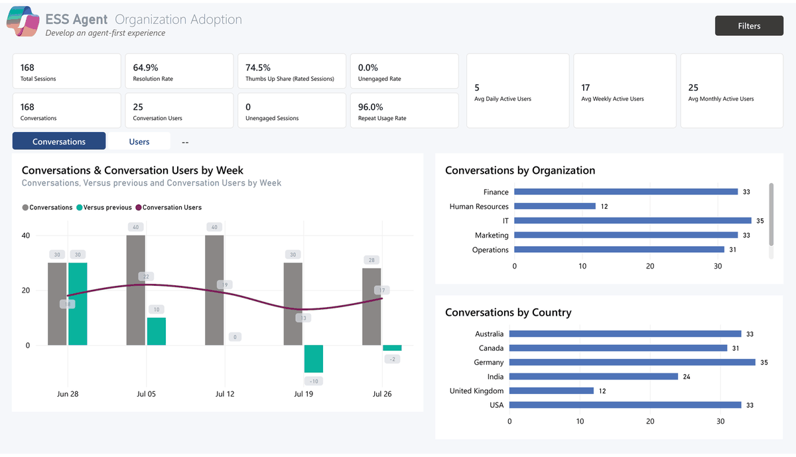

# Employee Self-Service Adoption Intelligence

Use this Power BI solution to understand adoption, conversation outcomes, employee feedback, topics, business impact, and improvement opportunities for Microsoft Copilot Studio Employee Self-Service agents.

> [!IMPORTANT]
> **Use the complete validated V23.2 package:** [download `ESS-039417f-optional-fixes-V23.2.zip`](https://github.com/microsoft/ESS/releases/download/dataverse-v23.2/ESS-039417f-optional-fixes-V23.2.zip), select **Extract All**, and keep the extracted folder structure intact. Do not download or run an individual `.cmd`, `.py`, or `.pbit` file from GitHub. The templates and Python modules were tested together. Python remains **3.10+**.

Preview resources:

- [Short ESS Insights overview video](https://github.com/user-attachments/assets/efa683f8-edec-4a53-897b-8e02fc112f3f)
- [YouTube overview (1m 41s)](https://youtu.be/dQqgcUs9Ly4)
- [ESS Insights Dashboard - Interpretation Guide](./ESS%20Insights%20Dashboard%20-%20Interpretation%20Guide.pptx)
- [Topic to Time Savings companion deck](./Topic%20to%20Time%20Savings.pptx)

## Start here

Before running a launcher:

1. [Download the complete V23.2 ZIP](https://github.com/microsoft/ESS/releases/download/dataverse-v23.2/ESS-039417f-optional-fixes-V23.2.zip) and select **Extract All**. Do not run files from inside the ZIP.
2. Ask a Power Platform administrator to assign the report account **Bot Transcript Viewer** and **ESS Power BI Transcript Reader** in the environment that hosts the agent. An equivalent custom role must provide organization-level Read on `conversationtranscript` and `systemuser`. **Environment Maker is not sufficient; System Administrator is not required.**
3. In [Power Apps](https://make.powerapps.com), select that environment, open **Developer resources**, and copy the **Environment URL**.
4. Install [Power BI Desktop](https://powerbi.microsoft.com/desktop/). Install [Python 3.10 or later](https://www.python.org/downloads/windows/) with **Add python.exe to PATH** only when using the guided setup or optional preparation tools.
5. Open the extracted package folder. Double-click `START-HERE-DATAVERSE.cmd`, or run `.\START-HERE-DATAVERSE.cmd` from PowerShell in that folder.

Complete three actions:

1. **Extract the validated package and choose one path.** Use the complete V23 release ZIP above, select **Extract All**, and choose Dataverse Direct, CSV Upload, or Fabric below.
2. **Validate the transcript-only baseline.** Follow only that path's guide and confirm the report works before adding other data.
3. **Enable only the report areas you need.** Dataverse URL-only users can open and publish the included [Service-ready Dataverse V23 PBIT](./ESS%20Dashboard%20-%20Dynamic%20Topics%20%28Dataverse%29%20V23%20-%20Power%20BI%20Service%20-%20PUBLISH%20THIS.pbit) without Python. It accepts topic-override JSON and prepared Monitor feedback that can reconcile to an exact loaded conversation. Use the guided setup for organization data, Microsoft 365 Product Feedback, registry inputs, or local Desktop validation files. Each enhancement is independent, including saved selections; organization-only setups are supported.

> [!IMPORTANT]
> Use the complete corrected V23 ZIP when using scripts, optional enhancements, CSV Upload, or Fabric. Do not mix individual scripts from different versions. Dataverse URL-only users can open the included V23 Service-ready PBIT directly.
>
> The Dataverse guided setup creates two intentional outputs. **Desktop Validation - LOCAL ONLY** checks optional local Organization and Credits files. **Power BI Service - PUBLISH THIS** is the separate publication output; it excludes local files but can refresh a cloud-hosted organization CSV from SharePoint Online or OneDrive for Business.
>
> New enhancements default to **No / skip**. For each saved enhancement, choose **keep**, **replace**, or **skip**; Enter skips. Cancelling the first replacement picker clears the old choice. See the [guided and CLI selection instructions](./SETUP-Dataverse.md#option-b---guided-setup-with-optional-enhancements), including explicit skip flags for non-interactive runs.

## Choose your data path

| Path | Best for | First setup | Refresh model | Start |
|---|---|---:|---|---|
| **Dataverse Direct - Recommended** | Ongoing reporting from one supported Dataverse environment | 15-25 min | Two-stage validation and publication; gateway-free Service refresh | **[Open the Dataverse guide](./SETUP-Dataverse.md)** |
| **CSV Upload** | Evaluation, snapshots, offline copies, or controlled sharing | 20-30 min | Export a new CSV and refresh | **[Open the CSV guide](./SETUP-CSV-Download.md)** |
| **Fabric - Advanced** | Multiple environments, durable Lakehouse history, or large-scale ingestion | 45-90 min | Scheduled notebooks plus Power BI refresh | **[Open the Fabric guide](./SETUP-Fabric.md)** |

### 1. [Dataverse Direct - Recommended](./SETUP-Dataverse.md)

Choose this path when the report will use one Production, Sandbox, or Default Dataverse environment. The only required template input is the Dataverse Environment URL; conversation data is read directly from Dataverse, not from an exported transcript CSV.

**Required access:** Bot Transcript Viewer plus ESS Power BI Transcript Reader. An equivalent customer-approved role must provide organization-level Read on `conversationtranscript` and `systemuser`. Environment Maker alone is not enough; System Administrator is not required.

**Included setup:** URL-only users can open the [Service-ready Dataverse V23 PBIT](./ESS%20Dashboard%20-%20Dynamic%20Topics%20%28Dataverse%29%20V23%20-%20Power%20BI%20Service%20-%20PUBLISH%20THIS.pbit), enter the required Environment URL, and optionally set Transcript Lookback Days or Customer Topic Overrides JSON. The Feedback Events JSON parameter is for prepared Monitor events that identify one exact loaded conversation; registry-dependent Microsoft 365 Product Feedback uses the guided setup. The direct PBIT is a transcript-only Service baseline and does not expose registry, Organization, or Credits file parameters. For gateway-free organization refresh, the guided builder validates the SharePoint/OneDrive CSV URL format and generates a customer-specific template with a static SharePoint source. Power BI refresh validates file existence, permissions, and schema. Rerun `BUILD-SERVICE-REFRESH.cmd` when the organization file location changes.

When the direct report opens, paste the Environment URL and leave optional parameters blank for the baseline. Guided users should wait until prefilled values are visible and stable before selecting **Load**.

**[Follow the Dataverse Direct steps ->](./SETUP-Dataverse.md)**

### 2. [CSV Upload](./SETUP-CSV-Download.md)

Choose this path for a one-time snapshot, a proof of concept, or a report that must be distributed without a live Dataverse connection. Export the transcript table, build a small agent registry, and open the included CSV template.

**Required access:** Bot Transcript Viewer, or a custom Dataverse role with organization-level Read on `conversationtranscript`.

**Included files:** [`ESS Dashboard - Dynamic Topics (CSV) V18.pbit`](./ESS%20Dashboard%20-%20Dynamic%20Topics%20%28CSV%29%20V18.pbit) and [`tools\agent_registry.py`](./tools/agent_registry.py).

**[Follow the CSV Upload steps ->](./SETUP-CSV-Download.md)**

### 3. [Fabric - Advanced](./SETUP-Fabric.md)

Choose this path only when you need multiple environments, independently governed history beyond the Dataverse retention window, or Lakehouse-based ingestion at scale. An administrator must configure an Entra application and a Dataverse Application User in every source environment.

**Required access:** Fabric workspace Contributor, Member, or Admin; an Entra app registration; and a Dataverse Application User with organization-level Read on `conversationtranscript`.

**Included files:** [`ESS - Fabric V2.pbit`](./ESS%20-%20Fabric%20V2.pbit), [`Copilot_Agent_Transcript_Parser.ipynb`](./Fabric/notebooks/Copilot_Agent_Transcript_Parser.ipynb), and the optional [`Copilot_Credit_Consumption_Ingester.ipynb`](./Fabric/notebooks/Copilot_Credit_Consumption_Ingester.ipynb).

**Report experience:** Fabric V2 uses Studio pages for topic exploration, conversation quality, performance, errors, feedback, knowledge files, value, and credit consumption. It does not use the CSV/Dataverse layout shown in the demo PBIX.

**[Follow the Fabric steps ->](./SETUP-Fabric.md)**

## What is required for the first successful report?

Each path guide shows the portal, exact click path, required role, expected output, and included helper beside the action that needs it.

| Path | Required input | Required role | Template and helper | Success checkpoint |
|---|---|---|---|---|
| **Dataverse Direct** | Dataverse Environment URL; no transcript CSV export | Bot Transcript Viewer plus ESS Power BI Transcript Reader, or equivalent organization-level Read on `conversationtranscript` and `systemuser` | [Service-ready PBIT or guided setup](./SETUP-Dataverse.md) | Total Conversations is non-zero |
| **CSV Upload** | Untouched `ConversationTranscript` CSV and validated `agent-registry.json` | Bot Transcript Viewer or custom organization-level transcript Read | [CSV V18](./ESS%20Dashboard%20-%20Dynamic%20Topics%20%28CSV%29%20V18.pbit) plus [`tools\agent_registry.py`](./tools/agent_registry.py) | Total Conversations is non-zero and the intended agent is shown |
| **Fabric** | Dataverse URL, application credentials, and `agent-registry.csv` | Fabric Contributor+; Entra/Power Platform admin help; Application User with transcript Read | [Fabric V2](./ESS%20-%20Fabric%20V2.pbit) plus [transcript-parser notebook](./Fabric/notebooks/Copilot_Agent_Transcript_Parser.ipynb) | Eight transcript tables exist and Total Conversations is non-zero |

Power BI Desktop is required for all three paths. The guided setup and optional local tools validate their own prerequisites.

## Optional data for full report functionality

These inputs enable specific report areas; they are not required for the transcript-only baseline. Validate the baseline first to isolate access or source errors, then load the data needed for the report functionality you intend to use.

| Enhancement | What it adds | Where to retrieve it | Required role | Included helper or guide |
|---|---|---|---|---|
| **Users / organization** | Department, country, job title, display name | Microsoft 365 admin center: **Users -> Active users -> Export users**, or an approved HR/Viva Insights/Graph source | Global Reader, User Administrator, or Global Administrator for the Microsoft 365 export; other sources use their own access model | CSV and Dataverse Desktop accept `OrgData.csv`; the Dataverse guided builder can embed a format-validated SharePoint/OneDrive CSV path as a static Service source; Universal Lake/Fabric can automate Entra ingestion |
| **Copilot Credits** | Observed tenant, agent, and user credit consumption | Power Platform admin center: **Licensing -> Copilot Studio -> Summary -> Download report** | Power Platform Administrator is recommended least privilege; tenant administrator or Dynamics 365 Administrator also works | CSV/Dataverse Desktop use the User-Level file; Fabric uses all three files and [`Copilot_Credit_Consumption_Ingester.ipynb`](./Fabric/notebooks/Copilot_Credit_Consumption_Ingester.ipynb) |
| **External Product Feedback** | Microsoft 365 Copilot Chat and exported Monitor reactions beyond the reactions already found in transcripts | Microsoft 365 admin center: **Health -> Product feedback -> Export to CSV** | A Microsoft 365 administrator or reader with Product Feedback access; Compliance Administrator or Global Administrator only when identity details or deletion are required | Dataverse prepares raw exports in its guided setup; CSV/Fabric use the [feedback guide](./FEEDBACK-INGESTION.md) |
| **Customer-specific topics** | Better coverage for customer language that meaningful native and built-in topics do not classify reliably | Use the bundled local multilingual model to group and prefill review suggestions; approved decisions become exact mappings, while repeated labeled evidence can produce reusable deterministic rules | Transcript read access and local permission to process the export; no Azure resource is required | Use the [local hybrid topic tuner](./TOPIC-TUNER.md) after validating the baseline |

To share the report or schedule refresh, follow the [refresh and publication guide](./AUTO-REFRESH.md) after the intended data sources work in Desktop.

## Included report files

The complete corrected V23 ZIP contains these report artifacts:

| File | Use |
|---|---|
| [`ESS Dashboard - Dynamic Topics (Dataverse) V23 - Power BI Service - PUBLISH THIS.pbit`](./ESS%20Dashboard%20-%20Dynamic%20Topics%20%28Dataverse%29%20V23%20-%20Power%20BI%20Service%20-%20PUBLISH%20THIS.pbit) | Default customer-neutral template for the validated V23 package. Use it directly for the four supported Service parameters, or use the guided setup for independently selected organization, registry, feedback, credits, and topic enhancements. |
| [`ESS Dashboard - Dynamic Topics (Dataverse) V22 - Power BI Service - PUBLISH THIS.pbit`](./ESS%20Dashboard%20-%20Dynamic%20Topics%20%28Dataverse%29%20V22%20-%20Power%20BI%20Service%20-%20PUBLISH%20THIS.pbit) | Unchanged pinned V22 template retained for comparison and rollback. V23 has its own updated topic-classification contract; V22 remains unchanged. |
| [`ESS Dashboard - Dynamic Topics (Dataverse) V21 - Power BI Service - PUBLISH THIS.pbit`](./ESS%20Dashboard%20-%20Dynamic%20Topics%20%28Dataverse%29%20V21%20-%20Power%20BI%20Service%20-%20PUBLISH%20THIS.pbit) | Previous Dataverse V21 design retained as a rollback backup. |
| [`ESS Dashboard - Dynamic Topics (CSV) V18.pbit`](./ESS%20Dashboard%20-%20Dynamic%20Topics%20%28CSV%29%20V18.pbit) | CSV Upload template |
| [`ESS - Fabric V2.pbit`](./ESS%20-%20Fabric%20V2.pbit) | Fabric/Lakehouse template |
| [`ESS Dashboard - DEMO PBIX.pbix`](./ESS%20Dashboard%20-%20DEMO%20PBIX.pbix) | Synthetic demonstration report; not a customer template |

V22 and V21 are retained unchanged for comparison and rollback.

**Validation:** 233 Python regression tests pass, with one expected skip when the optional standalone Power Query runtime is unavailable. The real bundled local ONNX model passed multilingual inference and hash validation, all 29 Python files pass a Python 3.10 grammar check, and offline builds cover the baseline, grouped semantic review, human-approved mappings, and eligible Desktop and Service enhancements. Authorized runtime QA previously completed clean Power BI Desktop and Service refreshes using the validated least-privilege roles. The optional Azure provider is not required for the local workflow and is not included in its release-readiness claim. See [`QA-V23.json`](./QA-V23.json) for provenance and validation evidence.

## Before collecting data

<strong>Confirm the environment and transcript settings</strong>

### Supported environment types

| Environment type | Transcripts written to Dataverse? | Supported for customer reporting? |
|---|---|---|
| Production | Yes | Yes |
| Sandbox | Yes | Yes |
| Default | Yes | Yes |
| Developer | Only the maker's conversations | Demo only |

Check the type in the [Power Platform admin center](https://admin.powerplatform.microsoft.com): **Manage -> Environments -> select the environment**. Microsoft 365 Copilot and Teams are publishing channels, not Dataverse environment types. Either can be a valid channel when the underlying Production, Sandbox, or Default environment supports transcript persistence.

### Enable the required transcript settings

1. In [Power Platform admin center](https://admin.powerplatform.microsoft.com), select **Manage -> Environments -> select the environment -> Settings -> Product -> Features -> Copilot Studio agents**, then enable saving conversation transcripts to Dataverse.
2. Open the agent in [Copilot Studio](https://copilotstudio.microsoft.com).
3. Select **Settings -> Advanced -> Conversation transcripts** and turn on **Include node-level details in transcripts**.
4. Save and publish the agent.
5. Test through an enabled published channel; generic `/webchat` is not required for Microsoft-authenticated agents.
6. End each new test conversation and allow approximately **30 minutes of inactivity** before expecting its row in Dataverse.

These settings affect future conversations only. Node-level details are required for topic, turn, duration, outcome, and parent/child-agent analysis.

### Plan the retention window

Dataverse commonly deletes conversation transcripts after 30 days through a recurring bulk-delete job. A longer report lookback does not restore deleted records.

To change retention, use the agent's **Settings -> Advanced -> Conversation transcripts** setting when available. A System Administrator can also review the environment's recurring job under **Settings -> Data management -> Bulk record deletion**.

[Microsoft Learn: manage conversation transcripts](https://learn.microsoft.com/en-us/microsoft-copilot-studio/analytics-transcripts-powerapps)

## What the CSV and Dataverse dashboard answers

| Page | Question answered |
|---|---|
| Executive Summary | What are the top adoption, outcome, quality, productivity, and value signals? |
| Conversation Outcomes | Which conversations resolve, escalate, or end without resolution? |
| Adoption | Who uses the agent, how often, and from which organizations? |
| Time to Knowledge | How long and how many turns does it take to help an employee? |
| Conversation Details | What happened in an individual conversation? |
| Business Impact | What ticket deflection, time savings, value, and credit consumption are modeled? |
| Improvement Opportunities | Which topics and child agents need authoring attention? |
| Agent Feedback | What do users like or dislike? |
| Adjust Topic Assumptions | Which time-saved assumptions should be reviewed for each topic? |
| Glossary | How is every metric defined and sourced? |

All CSV and Dataverse pages work from transcript data. Optional sources enrich specific visuals; they are not required to prove the baseline report. Fabric V2 presents the same source domains through its separate Studio/Lakehouse page set.

## Topic classification and privacy

- Copilot Studio's native topic remains authoritative when present.
- Conversations without a native topic use the shared English, Spanish, and Chinese taxonomy in `taxonomy/topics-taxonomy.csv`.
- Matching is conservative: complete words or phrases, scoring, exclusions, confidence, and ambiguity handling prevent weak matches from becoming business labels.
- Deterministic tuning and the default bundled multilingual semantic model run locally. Model and tokenizer hashes are verified before inference, and transcript text is not sent off-device.
- Local model results are suggestion-only. A person approves, corrects, or leaves each grouped pattern unclassified; approved decisions become prompt-free exact conversation-ID mappings.
- Azure OpenAI or Microsoft Foundry remains an explicit optional customer-owned provider, not a requirement.
- Power BI classification uses embedded mappings and deterministic rules. Desktop and Service refreshes never load or call a model.

See [Customer-specific topic tuning](./TOPIC-TUNER.md) for the optional post-validation workflow.

## Synthetic validation data

The [`SampleData`](./SampleData/) folder contains fabricated `example.com` users and synthetic identifiers. It is safe for demonstrations and validates the same contracts used by the templates.

| Sample | Purpose |
|---|---|
| `ConversationTranscripts.csv` | 168 fabricated conversations |
| `OrgData.csv` | Matching organization attributes |
| `agent-registry.csv` / `agent-registry.json` | Cross-source agent aliases |
| `feedback-events.csv` / `feedback-events.json` | Prepared cross-channel feedback |
| Three `*MCSMessages*` CSVs | Environment, agent, and user Copilot Credits contracts |

The synthetic credit files reconcile to **1,651.75 total credits**. CSV V18 and Dataverse V23 Desktop use the User-Level file; Fabric V2 uses all three.

## Help and reference

- [Agent registry and reporting scope](./AGENT-REGISTRY.md)
- [Cross-channel feedback ingestion](./FEEDBACK-INGESTION.md)
- [Customer-specific topic tuning](./TOPIC-TUNER.md)
- [Parent and child agent attribution](./CHILD-AGENT-ATTRIBUTION.md)
- [Automatic refresh and publication](./AUTO-REFRESH.md)
- [Open a GitHub issue](https://github.com/microsoft/ESS/issues)

## License

[MIT](./LICENSE)
